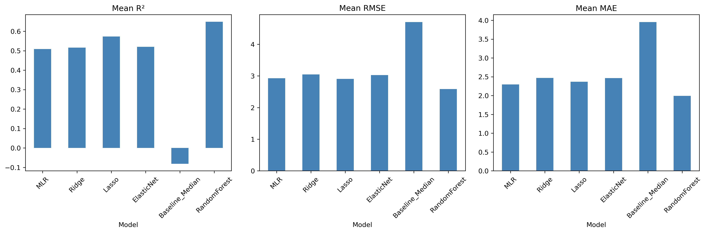
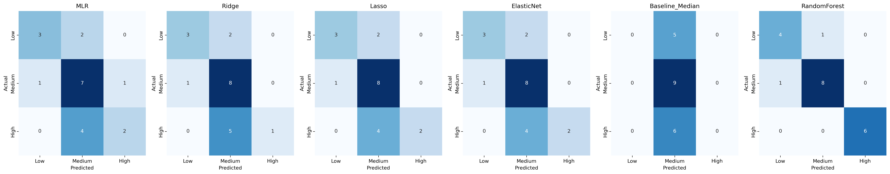

# Estimating Relative Malaria Case Count and Case Count Classification Across Nations Using Regression-Based Modeling

A regression-based machine learning project examining **99 countries** to estimate relative national malaria case burden using climatic, socioeconomic, and demographic indicators, and classify countries into Low, Medium, or High case-count tiers.

The project combines **Python data preparation, statistical analysis, and machine learning** with a Streamlit web application to make country-level malaria estimates more interpretable and accessible.

## Key Findings

* **Sanitation access was the strongest indicator of malaria case burden.** Countries with better access to sanitation generally had lower malaria case counts. This suggests that sanitation conditions are worth monitoring when assessing public health risks, although the analysis does not prove that better sanitation directly causes fewer malaria cases.
* **The model successfully identified 90% of countries' malaria burden categories.** Random Forest correctly classified 18 out of 20 test countries into Low, Medium, or High categories, including all 6 high-burden countries. This demonstrates its potential as a tool for preliminary public health assessment.
* **Geographic differences were more noticeable than climate patterns.** European countries generally had lower malaria case counts than African countries in the analysis. Rainfall and temperature, however, did not show statistically significant relationships with case counts at the country level.
* **Population size matters when comparing countries.** Adding total population to the analysis improved the Random Forest model's performance, suggesting that the number of people living in a country provides additional information when estimating its malaria burden.
* **Malaria burden categories are more useful than exact predictions.** The model's estimated case counts could differ substantially from actual figures. Presenting results as Low, Medium, or High therefore provides a more practical and understandable way to compare countries without implying that the model can predict exact case counts.
* **The application was positively received during usability testing.** Three participants gave the application an average rating of 4.24 out of 5, with interface and design receiving the highest rating of 4.73. This highlights the importance of presenting analytical results through an accessible interface, not just developing an accurate model.
* 
## Application

The final Streamlit application allows users to enter country-level demographic, socioeconomic, and climatic indicators to estimate relative malaria case burden.

The application provides:

* Estimated national malaria case count
* Low, Medium, or High case-count classification
* Color-coded prediction results
* Plain-language explanations of each classification
* Input validation and range warnings

**Streamlit Application:**

[Launch the Malaria Prediction Tool](https://malaria-prediction-tool.streamlit.app/)

**UI Mockup (Canva):**

[View the application UI mockup](https://canva.link/rp7bbex0mnm60k5)

> **Note:** The application is hosted on Streamlit Community Cloud, which may sleep after inactivity. If a wake-up screen appears, click to restart the application.

## Project Questions

The analysis was organized around one main research question and four supporting questions.

### 1. What factors are associated with national malaria case burden?

Which climatic, socioeconomic, and demographic indicators are significantly associated with malaria case counts across countries?

### 2. How accurately can malaria case counts be estimated?

How well can regression-based models estimate national malaria case burden using the selected indicators?

### 3. Which regression model performs best?

How do the candidate models compare in terms of R², RMSE, and MAE?

### 4. How accurately can countries be classified?

How effectively can the selected model classify countries into Low, Medium, and High malaria case-count tiers?

### 5. Which factors influence the predictions?

Which indicators contribute most significantly to the estimation of national malaria case burden?

---

# Data

### Dataset

**Relative Malaria Case Count Prediction Dataset**

* **Records collected:** 106 countries
* **Final records:** 99 countries
* **Period:** 2015–2024
* **Observations:** One median value per country
* **Predictors:** 7
* **Model terms:** 11 after one-hot encoding of WHO region
* **Target variable:** Median_Malaria_Cases
* **Derived output:** Case_Count_Tier (Low / Medium / High)

**Data Sources:**

* **WHO Global Health Observatory:** Malaria case data
* **World Bank:** GDP per capita, population density, urban population percentage, sanitation access, and total population
* **Open-Meteo:** Rainfall and temperature data
* **REST Countries API:** Capital-city coordinates used to retrieve climate data

The dataset combines public health, socioeconomic, demographic, and climatic indicators to examine their relationships with national malaria case burden.

The target variable represents the **median annual malaria case count per country from 2015 to 2024**, rather than malaria incidence or a time-series forecast.

### Limitations

The dataset has several limitations that should be considered when interpreting the results:

* The relatively small sample of 99 countries makes model evaluation sensitive to the countries included in each validation fold.
* Seven countries were excluded because of missing study variables, potentially limiting the generalizability of the findings.
* Climate measurements were obtained using capital-city coordinates, which may not accurately represent malaria-endemic areas within each country.
* The analysis uses a cross-sectional country-level representation and cannot capture changes in malaria burden over time.
* Approximately 40% of the variance in log-transformed case counts remains unexplained by the seven predictors.

---

# Data Preparation

The raw datasets from multiple public sources required cleaning, aggregation, and standardization before they could be used for statistical analysis and machine learning.

Python and Pandas were used to prepare the country-level dataset.

### Data Quality Checks

The preparation process included:

* Checking data completeness across countries
* Identifying missing observations
* Validating country-level records
* Performing Shapiro-Wilk normality tests on yearly country-level series
* Conducting Variance Inflation Factor (VIF) analysis to screen for multicollinearity
* Reviewing predictor distributions and correlations

### Missing Values

Countries with missing values in any study variable or WHO malaria data were excluded rather than imputed.

Of the 106 countries initially collected, 99 were retained for the final analysis.

This approach avoided introducing imputed values into the country-level dataset, although it reduced the final sample size.

### Aggregation

The original data contained annual observations from 2015 to 2024.

These observations were consolidated into one record per country using median aggregation.

Climate variables required additional processing:

* Temperature was averaged from daily observations into annual means.
* Rainfall was summed into yearly totals.
* Annual country-level values were subsequently aggregated into their respective 10-year median values.

### Feature Engineering

The following transformations and derived variables were prepared:

* Median aggregation of annual observations
* `log1p` transformation of the malaria case-count target
* One-hot encoding of WHO region
* Standardization of numerical predictors
* Quartile-based classification of malaria case counts into Low, Medium, and High tiers

### Encoding and Data Leakage Prevention

WHO region was treated as a categorical variable, while the remaining predictors were treated as continuous numerical variables.

One-hot encoding and standardization were incorporated into the machine learning pipelines.

The Q1 and Q3 tier thresholds were calculated using the raw training-set malaria case counts only.

Encoding, scaling, and threshold calculations were fitted using training data to prevent information leakage from the test set.

### Features Investigated and Rejected

Two additional variables were investigated but were not included in the final deployed model:

* **ITN coverage:** Excluded because of insufficient country coverage and missing observations concentrated in high-burden countries.
* **Health expenditure per capita:** Excluded because of high multicollinearity with GDP, with a VIF of approximately 13.

The resulting dataset was used for statistical analysis, model training, and evaluation.

---

# Analysis & Visualization

The prepared dataset was analyzed using statistical methods and machine learning to identify relationships between national malaria case burden and the selected predictors.

### Exploratory Data Analysis

Exploratory analysis was conducted to understand the distribution and relationships of the variables.

The analysis included:

* Distribution analysis of malaria case counts
* Pearson and Spearman correlation analysis
* Predictor relationship assessment
* Multicollinearity screening using VIF

Malaria case counts exhibited substantial right skewness, with a median of approximately 25,890 cases compared with a mean of approximately 1.57 million.

Because of this distribution, the target variable was transformed using `log1p` during model training.

### Statistical Analysis

Ordinary Least Squares (OLS) regression was used to examine the statistical significance of the selected predictors.

The analysis was conducted across all 99 countries using the log-transformed malaria case-count target.

The resulting model achieved:

* **R²:** 0.698
* **Adjusted R²:** 0.660
* **F-statistic:** 18.27
* **Significance:** p < .001

Sanitation access and the European region were statistically significant predictors at α = .05.

### Model Development

Six regression models were developed and compared:

* Median Baseline
* Multiple Linear Regression (MLR)
* Ridge Regression
* Lasso Regression
* Elastic Net Regression
* Random Forest Regression

Random Forest was included as a non-linear benchmark against the linear regression models.

The models were evaluated using an 80/20 training-test split, with 79 countries for training and 20 countries for testing.

Ridge, Lasso, and Elastic Net hyperparameters were selected through inner 5-fold cross-validation on the training data.

Repeated 5×5 cross-validation was also used for model comparison.

### Model Performance

The following results were obtained through repeated 5×5 cross-validation on the log-transformed target:

| Model | Mean R² | Mean RMSE | Mean MAE |
|---|---:|---:|---:|
| Random Forest | 0.5956 | 2.8155 | 2.2237 |
| Elastic Net | 0.5361 | 2.9305 | 2.3503 |
| Ridge | 0.5286 | 2.9366 | 2.3407 |
| MLR | 0.5108 | 2.9405 | 2.2686 |
| Lasso | 0.4961 | 3.0044 | 2.3995 |
| Baseline (Median) | -0.0810 | 4.7002 | 3.9539 |

Random Forest achieved the highest mean R² and lowest mean RMSE among the evaluated models.

### Tier Classification

Predicted malaria case counts were converted back to their original scale using `expm1` before being assigned to their corresponding classification tiers.

The classification thresholds were based on the training-set quartiles:

* **Low:** Below Q1
* **Medium:** From Q1 to Q3, inclusive
* **High:** Above Q3

Classification performance was evaluated using accuracy, confusion matrices, and per-tier precision, recall, and F1 scores.

| Model | Accuracy | Macro F1 |
|---|---:|---:|
| Random Forest | 0.90 | 0.90 |
| Lasso | 0.60 | 0.58 |
| MLR | 0.55 | 0.50 |
| Elastic Net | 0.55 | 0.54 |
| Ridge | 0.50 | 0.46 |
| Baseline (Median) | 0.45 | 0.21 |

Random Forest correctly classified:

* 4 out of 5 Low-burden countries
* 8 out of 9 Medium-burden countries
* 6 out of 6 High-burden countries

<caption>Model comparison metrics</caption>



<caption>Confusion matrices across all evaluated models</caption>



### Sensitivity Analysis

An additional sensitivity analysis was conducted by introducing total population as an eighth predictor.

The analysis examined whether the findings from the original seven-predictor model remained consistent after accounting for total population.

The results showed that:

* Sanitation and European-region findings remained almost unchanged.
* Total population was positively associated with malaria case counts (B = 0.664, p = .034).
* Random Forest's cross-validated R² improved from 0.596 to 0.649.

The seven-predictor model remained the final deployed model.

---

# Key Insights

## 1. Sanitation Access Is the Most Consistent Predictor

Sanitation access emerged as the most consistently influential factor across the evaluated models.

It was statistically significant in OLS regression, ranked first in Random Forest feature importance with an importance score of 0.59, and remained influential after introducing total population in the sensitivity analysis.

Countries with higher sanitation access generally had lower predicted malaria case counts.

However, this represents an association and does not establish a causal relationship.

## 2. Geographic Region Matters More Than Climate in This Analysis

The European region was statistically associated with lower malaria case counts compared with the African reference region.

In contrast, rainfall and temperature were not statistically significant predictors in the OLS analysis.

This does not necessarily contradict research identifying climatic influences on malaria transmission. The country-level median approach and capital-city climate measurements may not capture localized or seasonal climate effects.

## 3. Random Forest Performs Best in Tier Classification

Random Forest achieved the highest cross-validated mean R² among the evaluated models and demonstrated the strongest classification performance on the held-out test set.

Although MLR performed best on the individual 80/20 split for regression metrics, Random Forest demonstrated a stronger ability to distinguish between the three malaria case-count tiers.

It correctly identified all six High-burden countries in the test set.

Nevertheless, its lead in cross-validated R² over the linear models was relatively modest compared with its fold-to-fold variability.

## 4. Classification Tiers Are More Appropriate Than Exact Predictions

Malaria case counts exhibited substantial variability, and predictions had typical errors of approximately 17 times on the original scale.

Consequently, presenting exact predicted case counts without context could create a misleading impression of precision.

The Low, Medium, and High classifications provide a more interpretable representation of relative malaria case burden.

## 5. Interpretability Matters in the Application

Usability testing with three stakeholders produced an overall mean rating of 4.24 out of 5.

Interface and design received the highest rating at 4.73.

Participants also emphasized the importance of understandable explanations for the classification results, which informed the addition of plain-language tier descriptions to the application.

---

# Recommendations

Based on the findings and limitations of the analysis, several recommendations were identified.

### Public Health and Research Applications

* Use the classification tiers for rough prioritization and preliminary assessment rather than exact malaria case forecasting.
* Monitor sanitation access alongside malaria case burden, while recognizing that the observed association does not establish causation.
* Interpret country-level estimates carefully, particularly for countries with substantial internal geographic and climatic variation.

### Future Research

* Expand country coverage as WHO reporting improves.
* Investigate additional machine learning approaches, including Gradient Boosting and Stacking.
* Replace capital-city climate measurements with population-weighted climate values.
* Explore total population as an additional predictor.
* Consider malaria incidence per 100,000 population as an alternative outcome.
* Introduce subnational and time-series analysis to capture geographic and temporal variation.

### Application Improvements

* Add a color-coded overview of all 99 countries.
* Implement CSV batch-prediction functionality.
* Refine input field labels and tooltips.
* Explore containerized deployment using Docker for more consistent application availability.
* Introduce a retraining pipeline when WHO and World Bank datasets are updated.

---

# Tools & Technologies

* **Python 3.10**
* **Pandas**
* **NumPy**
* **SciPy**
* **Scikit-learn**
* **Statsmodels**
* **Matplotlib**
* **Seaborn**
* **Streamlit**
* **Joblib**
* **Jupyter Notebook**
* **VS Code**
* **Conda**
* **Git & GitHub**
* **pip-tools**
* **WHO Global Health Observatory**
* **World Bank Open Data**
* **Open-Meteo API**
* **REST Countries API**
* **Canva**

### Workflow

`Public Data Sources → Data Collection → Data Cleaning & Aggregation → Exploratory Analysis → Statistical Analysis → Model Training & Evaluation → Tier Classification → Streamlit Application → System & Usability Testing`

---

# Project Structure

```text
Capstone2-A3101-Group2-SY26-27/
├── app/
│   ├── __pycache__/
│   ├── app_ui.py
│   └── validation.py
├── figures/
│   ├── confusion_matrices_all_models.png
│   └── model_comparison_metrics.png
├── ipynb_notebooks/
│   ├── 01_data_cleaning.ipynb
│   ├── 02_model_training.ipynb
│   ├── 03_sensitivity_analysis.ipynb
│   ├── 04_model_training_with_datamining.ipynb
│   ├── Capstone2-A3101-Group2-SY26-27.code-workspace
│   ├── country_coordinates.csv
│   ├── fig11.png
│   ├── fig12.png
│   ├── final_extract_dataset.csv
│   ├── final_malaria_dataset_1.jasp
│   ├── final_malaria_dataset.jasp
│   ├── median_malaria_per_nation.csv
│   ├── rainfall_cache.csv
│   └── temp_cache.csv
├── models/
│   ├── model_Baseline_Median.pkl
│   ├── model_ElasticNet.pkl
│   ├── model_Lasso.pkl
│   ├── model_MLR.pkl
│   ├── model_RandomForest.pkl
│   ├── model_Ridge.pkl
│   ├── tier_thresholds.pkl
│   └── your_model_file.pkl
├── spreadsheets/
│   ├── GDP_data/
│   ├── Population_density/
│   ├── API_SH.XPD.CHEX.GD.ZS_DS2_en_csv_v2_33342.csv
│   ├── API_SP.POP.TOTL_DS2_en_csv_v2_5254.csv
│   ├── health_expednditure_per_GDP.csv
│   ├── healthcaare_expenditure_updated.csv
│   ├── healthcare expenditure.csv
│   ├── malaria.csv
│   ├── medical_capacity.csv
│   ├── urbanization.csv
│   └── washdata.csv
├── test_env/
│   ├── bin/
│   ├── etc/
│   ├── include/
│   ├── lib/
│   ├── share/
│   └── pyvenv.cfg
├── tests/
│   └── test_validation_state.py
├── .gitignore
├── README.md
├── requirements.in
└── requirements.txt
```

---

# Conclusion

This project explored the relationships between climatic, socioeconomic, and demographic indicators and national malaria case burden across 99 countries.

The analysis demonstrated that regression-based machine learning can provide an interpretable, multi-country approach to estimating relative malaria case burden. Random Forest achieved 90% classification accuracy on the held-out test set and correctly identified all six High-burden countries.

Sanitation access emerged as the most consistent factor associated with malaria case burden across the evaluated models, while geographic region also demonstrated statistical significance.

More broadly, the project demonstrates how **data collection, cleaning, statistical inference, machine learning, model evaluation, and application development can be combined into an end-to-end data analytics solution**.

The final Streamlit application translates the model's outputs into accessible classifications, making the results easier to interpret without overstating the precision of the predictions.

The findings are promising rather than definitive, particularly given the relatively small dataset and the limitations of country-level climate measurements.

---

# Author

**David Zachary Ilaigilag Malonjao**

BSIT Data Analytics Student | Mapúa Malayan Digital College

**Team Members:** Caylyne Janae Lucero · Jose Martin Marquez · Jovelyn Plaga

**Adviser:** John Edmon Alcomendas

**Skills demonstrated:** Python · Pandas · NumPy · Data Cleaning · Exploratory Data Analysis · Statistical Analysis · OLS Regression · Machine Learning · Regression Modeling · Random Forest · Model Evaluation · Feature Engineering · Data Visualization · Streamlit Development · Input Validation · Software Testing · Git & GitHub

**GitHub Repository:**

[Capstone2-A3101-Group2-SY26-27](https://github.com/ZacharyMalonjao/Capstone2-A3101-Group2-SY26-27)

**Live Application:**

[Malaria Prediction Tool – Streamlit](https://malaria-prediction-tool.streamlit.app/)
